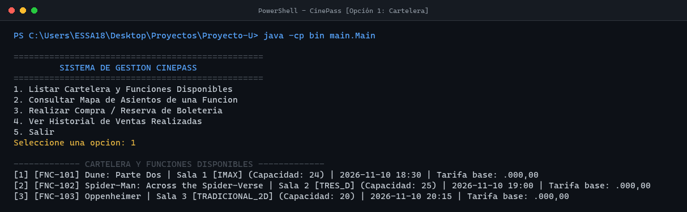
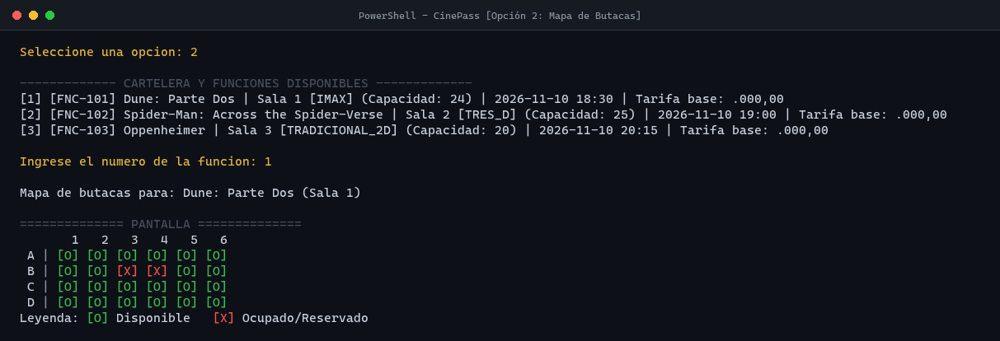
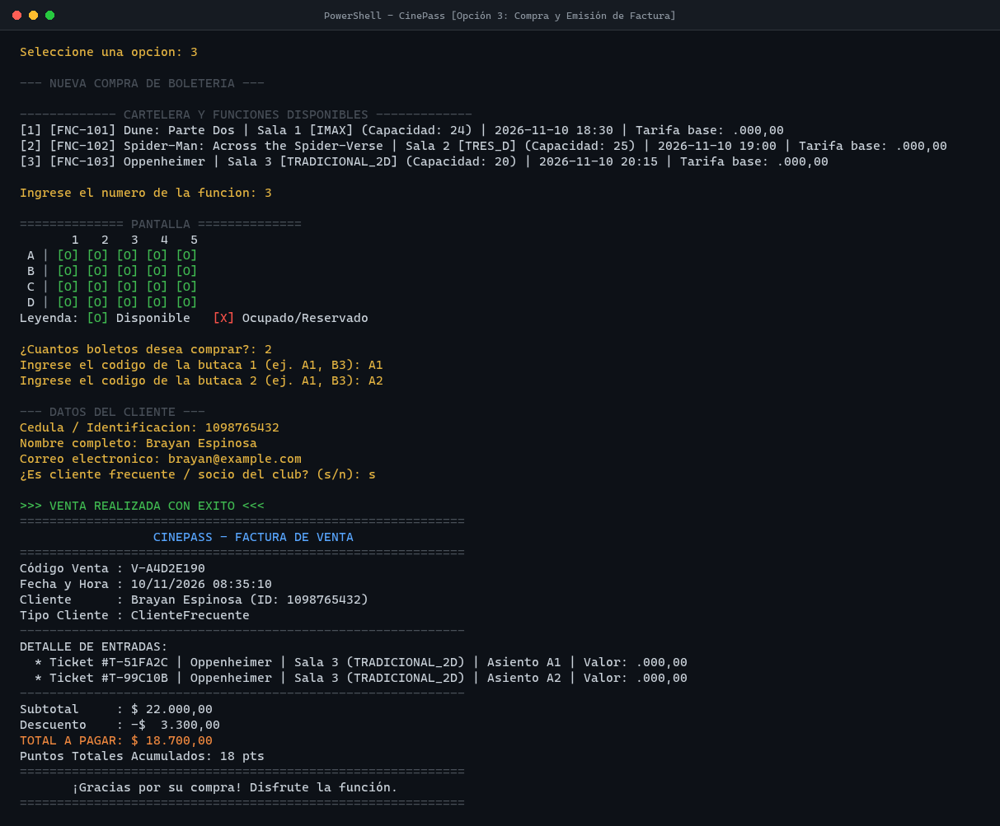
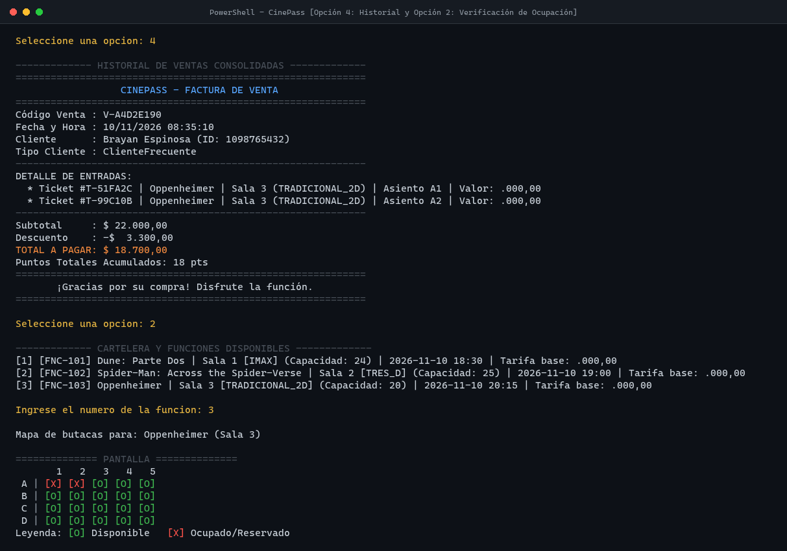

# 🎬 CinePass Java - Sistema de Gestión y Reserva de Boletería de Cine

[](https://openjdk.org/)
[](https://es.wikipedia.org/wiki/Programaci%C3%B3n_orientada_a_objetos)
[-green.svg?style=flat-square)](informe_entregable2.pdf)

> Sistema de gestión de taquilla, reservas y asignación matricial de asientos para salas de cine desarrollado en **Java SE**, con arquitectura desacoplada por capas e implementación rigurosa de los cuatro pilares de la **Programación Orientada a Objetos (POO)**.

---

## 📌 Tabla de Contenidos
1. [Descripción General](#-descripción-general)
2. [Arquitectura del Proyecto](#-arquitectura-del-proyecto)
3. [Pilares POO Aplicados](#-pilares-poo-aplicados)
4. [Estructura del Repositorio](#-estructura-del-repositorio)
5. [Instalación y Ejecución](#-instalación-y-ejecución)
6. [Demostración y Flujos Clave](#-demostración-y-flujos-clave)
7. [Documentación Oficial](#-documentación-oficial)

---

## 📖 Descripción General

**CinePass** modela la lógica transaccional de un complejo cinematográfico moderno. Permite gestionar películas, salas de diferentes formatos tecnológicos (Tradicional 2D, 3D e IMAX), programación de funciones en horarios definidos, control matricial de butacas en tiempo real, liquidación de precios con multiplicadores por sala y emisión de facturación con beneficios de fidelización.

---

## 🏛 Arquitectura del Proyecto

El sistema adopta una arquitectura modular desacoplada distribuida en tres paquetes principales:

```text
src/
├── model/           # Entidades del dominio y reglas de negocio
│   ├── Asiento.java             # Coordenada física en sala (fila/número)
│   ├── Boleto.java              # Ticket emitido con tarifa final liquidada
│   ├── Cliente.java             # Superclase abstracta base
│   ├── ClienteFrecuente.java    # Subclase con descuento preferencial y puntos
│   ├── ClienteGeneral.java      # Subclase para cliente estándar sin membresía
│   ├── EstadoAsiento.java       # Enum: DISPONIBLE, RESERVADO, OCUPADO
│   ├── Funcion.java             # Agregación: Película, Sala, Horario y Matriz de Asientos
│   ├── Pelicula.java            # Catálogo de filmes y metadatos
│   ├── Sala.java                # Especificación del espacio físico y capacidad
│   ├── TipoSala.java            # Enum con multiplicadores tarifarios
│   └── Venta.java               # Agregación comercial: boletos, liquidación y comprobante
├── controller/      # Capa de orquestación de servicios y estado
│   └── CineController.java      # Controlador de negocio (catálogo, reservas y ventas)
└── main/            # Capa de presentación por consola
    └── Main.java                # Interfaz CLI interactiva y orquestación
```

---

## 🧩 Pilares POO Aplicados

| Pilar | Aplicación en CinePass |
|---|---|
| **Abstracción** | Clase base `Cliente` que modela la esencia del usuario comprador, exponiendo la firma abstracta `calcularDescuento(double subtotal)` sin comprometerse con una regla fija. |
| **Herencia** | `ClienteGeneral` y `ClienteFrecuente` extienden de `Cliente`, heredando atributos de identidad y contacto, y especializando el comportamiento financiero. |
| **Polimorfismo** | En `Venta.calcularTotal()`, la invocación de `cliente.calcularDescuento()` resuelve dinámicamente la tasa según el tipo de instancia en tiempo de ejecución (0% para general, 15% para cliente frecuente + cálculo de puntos). |
| **Encapsulamiento** | La disponibilidad de butacas se gestiona en `Funcion` mediante colecciones privadas y métodos controlados (`ocuparAsiento`, `estaDisponible`), impidiendo modificaciones arbitrarias sin validar el estado previo. |

---

## 📁 Estructura del Repositorio

```text
.
├── .gitignore
├── README.md                    # Documentación del repositorio
├── informe_entregable2.pdf      # Informe técnico formal universitario
├── bin/                         # Binarios compilados (.class)
├── docs/
│   └── screenshots/             # Evidencias visuales de consola
│       ├── 01_cartelera_funciones.png
│       ├── 02_mapa_asientos.png
│       ├── 03_compra_facturacion.png
│       └── 04_historial_y_actualizacion.png
└── src/                         # Código fuente en Java
    ├── controller/
    ├── main/
    └── model/
```

---

## 🚀 Instalación y Ejecución

### Requisitos Previos
* **Java Development Kit (JDK) 17 o superior** (probado y certificado en OpenJDK 21 LTS).

### 1. Clonar el Repositorio
```bash
git clone https://github.com/bespinosaosorio96/CinePass-Java.git
cd CinePass-Java
```

### 2. Compilar el Código Fuente
```bash
javac -d bin -encoding UTF-8 (Get-ChildItem -Recurse src/*.java | ForEach-Object { $_.FullName })
```
*O en sistemas Unix / Bash:*
```bash
javac -d bin -encoding UTF-8 $(find src -name "*.java")
```

### 3. Ejecutar la Aplicación Interactiva
```bash
java -cp bin main.Main
```

---

## 📸 Demostración y Flujos Clave

### 1. Menú Principal y Listado de Cartelera
Muestra la lista de funciones programadas con información de películas, salas, formatos tecnológicos y tarifas base.



---

### 2. Mapa Matricial de Butacas
Representación gráfica de filas y columnas con leyenda de estados: `[O]` Disponible, `[X]` Ocupado / Reservado.



---

### 3. Compra Transaccional con Descuento Polimórfico
Proceso guiado de selección de asientos contiguos, validación de disponibilidad en tiempo real, cálculo de descuento (15% cliente frecuente) y emisión de factura con ticket fiscal y puntos acumulados.



---

### 4. Historial Consolidado y Actualización de Matriz
Confirmación de almacenamiento transaccional en el controlador y comprobación de que los asientos comprados pasan de inmediato al estado ocupado `[X]`.



---

## 📑 Documentación Oficial

El informe académico formal completo con los diagramas de clases, descripción arquitectónica exhaustiva, justificación de patrones de diseño y conclusiones se encuentra en el archivo:

👉 **[informe_entregable2.pdf](informe_entregable2.pdf)**
