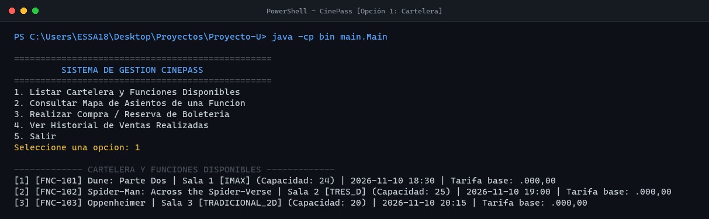
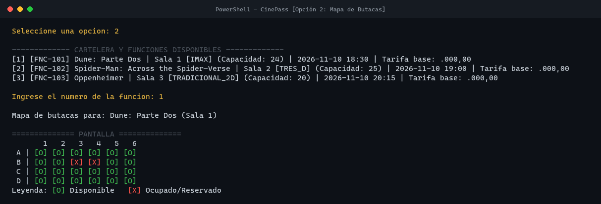
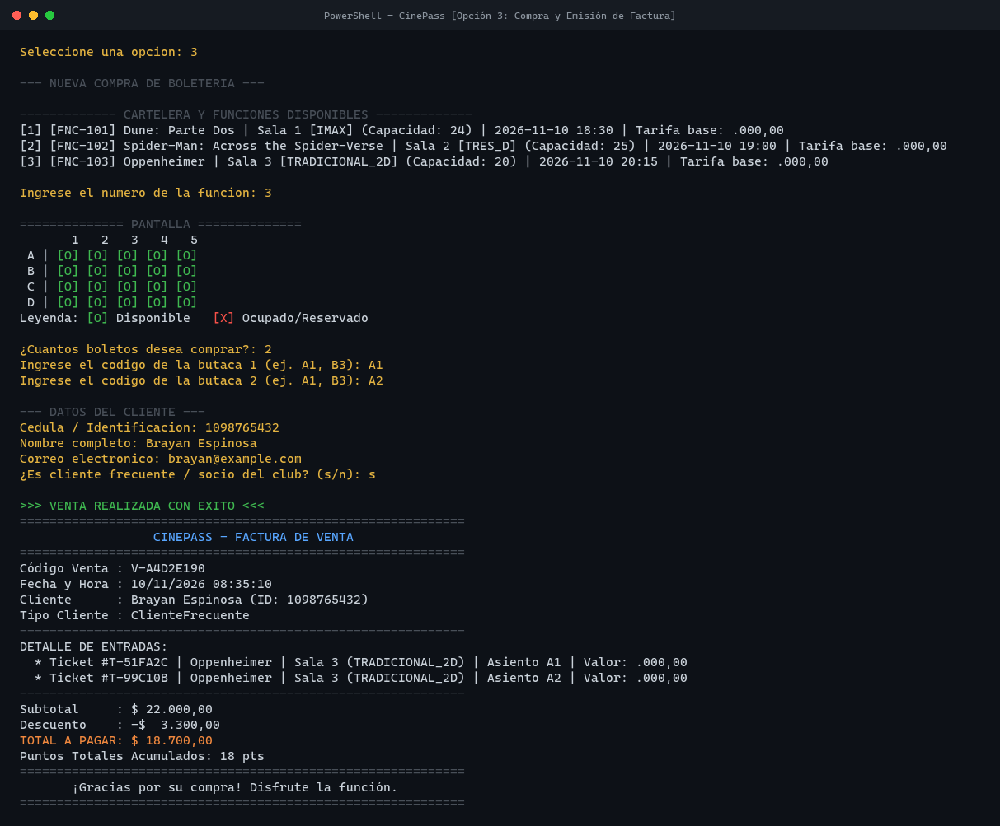
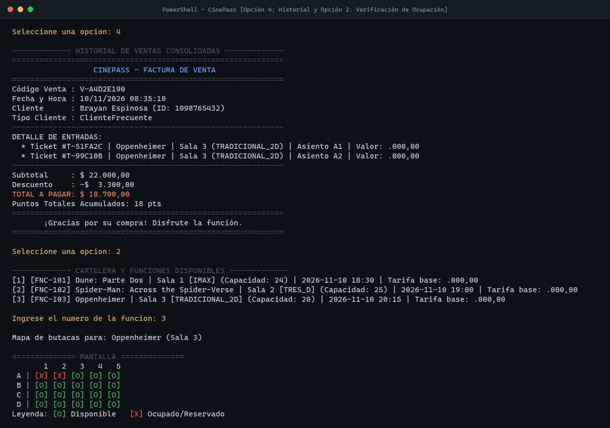
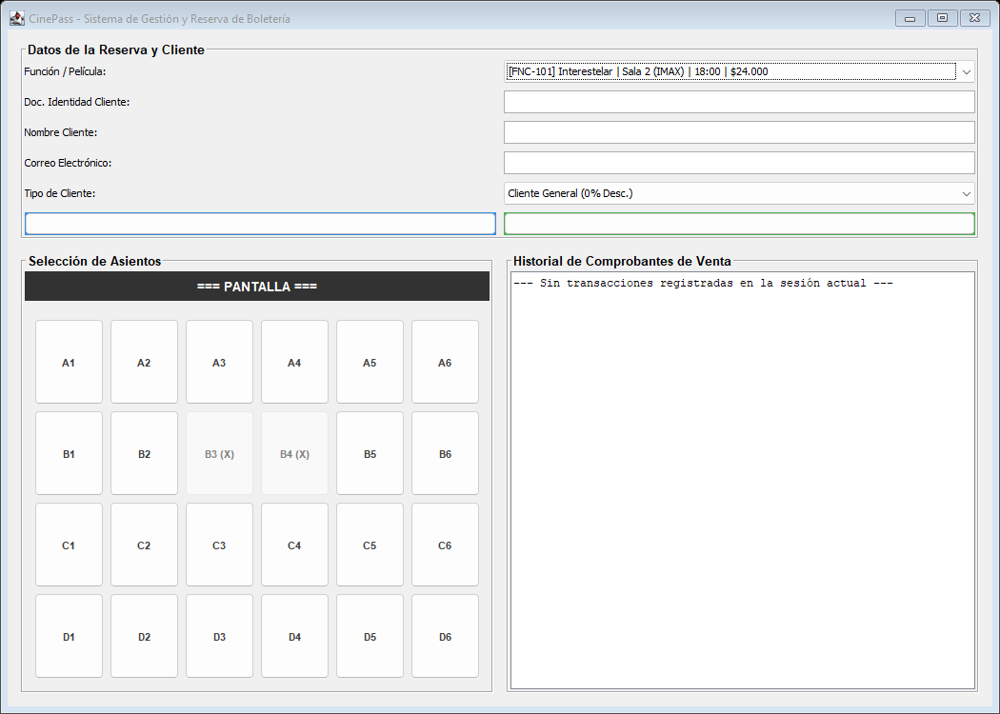
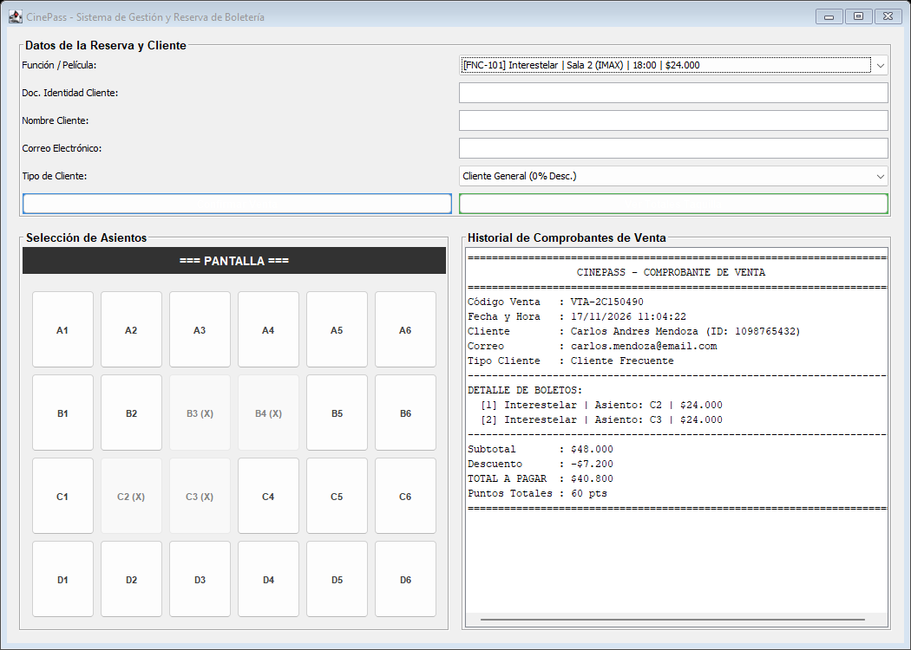
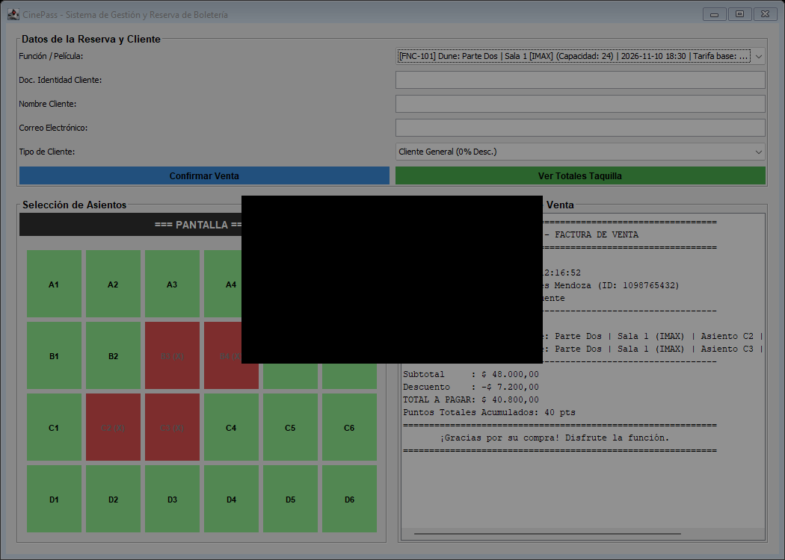

# CINEPASS - SISTEMA DE GESTIÓN Y RESERVA DE BOLETERÍA DE CINE
## INFORME TÉCNICO DE SOFTWARE — ENTREGA FINAL

**Materia:** Programación Orientada a Objetos  
**Docente:** Profesor Genner Carrillo  

**Presentado por:**  
- Brayan Espinosa Osorio  
- Samuel Leonardo Moreno Fuentes  

**Fecha de Entrega:** 17 de noviembre de 2026  
**Entregable:** Entrega Final — Arquitectura Orientada a Objetos, Demostración por Consola e Interfaz Gráfica Interactiva (Java Swing)  

---

## 1. INTRODUCCIÓN Y ALCANCE

El presente documento técnico recopila los artefactos de software desarrollados para el sistema **CinePass**, una solución integral desarrollada en **Java SE** orientada a la gestión de taquilla, control matricial de butacas en salas cinematográficas y facturación transaccional con beneficios de fidelización.

El sistema consolida los cuatro pilares fundamentales de la **Programación Orientada a Objetos (POO)**:
- **Abstracción:** Modelado formal de las entidades del dominio (`Cliente`, `Pelicula`, `Sala`, `Funcion`, `Boleto`, `Venta`).
- **Encapsulamiento:** Ocultamiento riguroso de colecciones internas y validación de estados de butacas mediante interfaces públicas seguras en el controlador y modelos.
- **Herencia:** Jerarquía de usuarios a partir de la superclase abstracta `Cliente`, especializada en `ClienteGeneral` y `ClienteFrecuente`.
- **Polimorfismo:** Resolución dinámica en tiempo de ejecución del cálculo de descuentos y fidelización de clientes.

Asimismo, la arquitectura desacoplada del sistema soporta dos capas de presentación funcionales:
1. Interfaz interactiva por consola CLI (`Main.java`).
2. Interfaz gráfica de escritorio desarrollada en **Java Swing** (`VentanaCine.java`).

---

## 2. ARQUITECTURA DEL PROYECTO (Plantilla de Clases en `.java`)

El sistema organiza sus responsabilidades según el estándar de diseño orientado a objetos distribuido en tres paquetes principales:

```text
src/
├── controller/
│   └── CineController.java      # Controlador de negocio (catálogo, reservas, ventas y balance)
├── model/                       # Capa de dominio y reglas de negocio
│   ├── Asiento.java             # Coordenada física en sala (fila/número)
│   ├── Boleto.java              # Ticket emitido con tarifa final liquidada
│   ├── Cliente.java             # Superclase abstracta base
│   ├── ClienteFrecuente.java    # Subclase con descuento preferencial (15%) y acumulación de puntos
│   ├── ClienteGeneral.java      # Subclase para cliente estándar sin beneficios
│   ├── EstadoAsiento.java       # Enum: DISPONIBLE, RESERVADO, OCUPADO
│   ├── Funcion.java             # Agregación: Película, Sala, Horario y Matriz de Asientos
│   ├── Pelicula.java            # Catálogo de filmes y metadatos
│   ├── Sala.java                # Especificación del espacio físico y capacidad
│   ├── TipoSala.java            # Enum con multiplicadores tarifarios (2D, 3D, IMAX)
│   └── Venta.java               # Agregación comercial: boletos, liquidación y comprobante
└── main/                        # Capa de presentación y ejecución
    ├── Main.java                # Interfaz CLI interactiva por consola
    └── VentanaCine.java         # Interfaz gráfica de escritorio en Java Swing
```

### Justificación de Mecanismos POO Implementados
1. **Polimorfismo en Descuentos:** `Cliente` define la firma abstracta `calcularDescuento(double subtotal)`. `Venta` invoca el cálculo sin importar la instancia en tiempo de ejecución (`ClienteGeneral` o `ClienteFrecuente`), respetando el principio Abierto/Cerrado (*Open/Closed Principle*).
2. **Encapsulamiento de Butacas:** La matriz de disponibilidad se controla internamente en `Funcion` mediante una colección `Map<String, EstadoAsiento>`. Los asientos físicos no pueden ser reasignados arbitrariamente sin validar el estado previo a través de `estaDisponible()`.
3. **Composición Transaccional:** `Venta` se compone estrictamente de instancias de `Boleto`. Si se cancela la venta, el conjunto de boletos se anula como unidad lógica de negocio inmutable.
4. **Desacoplamiento Vista-Controlador:** Tanto la interfaz por consola (`Main`) como la ventana gráfica (`VentanaCine`) consumen exclusivamente los servicios expuestos por `CineController`, garantizando alta cohesión y bajo acoplamiento.

---

## 3. DEMOSTRACIÓN DEL PROYECTO POR CONSOLA

A continuación se presentan las evidencias de ejecución de los flujos operacionales capturados en el entorno de consola.

### Evidencia 1: Cartelera y Funciones Disponibles (Opción 1)
Despliega la oferta de películas, salas asociadas, formatos de proyección y tarifas base calculadas.



```text
=================================================
         SISTEMA DE GESTION CINEPASS             
=================================================
1. Listar Cartelera y Funciones Disponibles
2. Consultar Mapa de Asientos de una Funcion
3. Realizar Compra / Reserva de Boleteria
4. Ver Historial de Ventas Realizadas
5. Salir
Seleccione una opcion: 1

------------- CARTELERA Y FUNCIONES DISPONIBLES -------------
[1] [FNC-101] Dune: Parte Dos | Sala 1 [IMAX] (Capacidad: 24) | 2026-11-10 18:30 | Tarifa base: $16.000,00
[2] [FNC-102] Spider-Man: Across the Spider-Verse | Sala 2 [TRES_D] (Capacidad: 25) | 2026-11-10 19:00 | Tarifa base: $14.000,00
[3] [FNC-103] Oppenheimer | Sala 3 [TRADICIONAL_2D] (Capacidad: 20) | 2026-11-10 20:15 | Tarifa base: $11.000,00
```

---

### Evidencia 2: Consulta de Ocupación de Butacas (Opción 2)
Representación matricial de filas y columnas. Se observa el estado de los asientos pre-reservados `[X]` y disponibles `[O]`.



```text
Seleccione una opcion: 2

------------- CARTELERA Y FUNCIONES DISPONIBLES -------------
[1] [FNC-101] Dune: Parte Dos | Sala 1 [IMAX] (Capacidad: 24) | 2026-11-10 18:30 | Tarifa base: $16.000,00
[2] [FNC-102] Spider-Man: Across the Spider-Verse | Sala 2 [TRES_D] (Capacidad: 25) | 2026-11-10 19:00 | Tarifa base: $14.000,00
[3] [FNC-103] Oppenheimer | Sala 3 [TRADICIONAL_2D] (Capacidad: 20) | 2026-11-10 20:15 | Tarifa base: $11.000,00

Ingrese el numero de la funcion: 1

Mapa de butacas para: Dune: Parte Dos (Sala 1)

============== PANTALLA ==============
       1   2   3   4   5   6
 A | [O] [O] [O] [O] [O] [O]
 B | [O] [O] [X] [X] [O] [O]
 C | [O] [O] [O] [O] [O] [O]
 D | [O] [O] [O] [O] [O] [O]
Leyenda: [O] Disponible   [X] Ocupado/Reservado
```

---

### Evidencia 3: Transacción de Compra y Facturación (Opción 3)
Adquisición de dos boletos contiguos (`A1` y `A2`) para la función de *Oppenheimer* por un cliente suscrito al club de fidelización. Se evidencia la aplicación automática del 15% de descuento y la suma de puntos.



```text
Seleccione una opcion: 3

--- NUEVA COMPRA DE BOLETERIA ---

------------- CARTELERA Y FUNCIONES DISPONIBLES -------------
[1] [FNC-101] Dune: Parte Dos | Sala 1 [IMAX] (Capacidad: 24) | 2026-11-10 18:30 | Tarifa base: $16.000,00
[2] [FNC-102] Spider-Man: Across the Spider-Verse | Sala 2 [TRES_D] (Capacidad: 25) | 2026-11-10 19:00 | Tarifa base: $14.000,00
[3] [FNC-103] Oppenheimer | Sala 3 [TRADICIONAL_2D] (Capacidad: 20) | 2026-11-10 20:15 | Tarifa base: $11.000,00

Ingrese el numero de la funcion: 3

============== PANTALLA ==============
       1   2   3   4   5
 A | [O] [O] [O] [O] [O]
 B | [O] [O] [O] [O] [O]
 C | [O] [O] [O] [O] [O]
 D | [O] [O] [O] [O] [O]
Leyenda: [O] Disponible   [X] Ocupado/Reservado

¿Cuantos boletos desea comprar?: 2
Ingrese el codigo de la butaca 1 (ej. A1, B3): A1
Ingrese el codigo de la butaca 2 (ej. A1, B3): A2

--- DATOS DEL CLIENTE ---
Cedula / Identificacion: 1098765432
Nombre completo: Brayan Espinosa
Correo electronico: brayan@example.com
¿Es cliente frecuente / socio del club? (s/n): s

>>> VENTA REALIZADA CON EXITO <<<
============================================================
                  CINEPASS - FACTURA DE VENTA               
============================================================
Código Venta : V-A4D2E190
Fecha y Hora : 10/11/2026 08:35:10
Cliente      : Brayan Espinosa (ID: 1098765432)
Tipo Cliente : ClienteFrecuente
------------------------------------------------------------
DETALLE DE ENTRADAS:
  * Ticket #T-51FA2C | Oppenheimer | Sala 3 (TRADICIONAL_2D) | Asiento A1 | Valor: $11.000,00
  * Ticket #T-99C10B | Oppenheimer | Sala 3 (TRADICIONAL_2D) | Asiento A2 | Valor: $11.000,00
------------------------------------------------------------
Subtotal     : $ 22.000,00
Descuento    : -$  3.300,00
TOTAL A PAGAR: $ 18.700,00
Puntos Totales Acumulados: 18 pts
============================================================
       ¡Gracias por su compra! Disfrute la función.        
============================================================
```

---

### Evidencia 4: Historial Consolidado y Validación de Integridad (Opciones 4 y 2)
Comprobación del almacenamiento de la venta en el controlador y actualización inmediata de la matriz (asientos `A1` y `A2` ahora marcados como ocupados `[X]`).



---

## 4. ENTREGABLE DE INTERFAZ GRÁFICA Y PROYECTO FUNCIONAL (Swing GUI)

### 4.1 Arquitectura de Componentes Swing Empleada
La interfaz gráfica de usuario está construida utilizando el conjunto de componentes y gestores de diseño de **Java Swing**:

- **`JFrame` (`VentanaCine`):** Contenedor de nivel superior de la aplicación. Configura una ventana de 1050x750 píxeles, con dimensiones mínimas controladas, centrado automático en pantalla (`setLocationRelativeTo(null)`), cierre seguro (`EXIT_ON_CLOSE`) y adaptación al *Look & Feel* nativo del sistema operativo anfitrión.
- **`JPanel`:** Se estructuran paneles modulares con bordes biselados y títulos (`TitledBorder`) para separar limpiamente las zonas de captura de datos, selección de butacas y visualización de resultados.
- **`BorderLayout`:** Actúa como gestor principal del contenedor raíz, posicionando el panel de control y formulario en la zona norte (`BorderLayout.NORTH`) y el área operacional en el centro (`BorderLayout.CENTER`).
- **`GridLayout`:** Implementado en dos niveles estratégicos:
  - En el formulario de cliente y reserva (`GridLayout(6, 2, 8, 8)`), organizando equitativamente etiquetas descriptivas y campos de entrada.
  - En la matriz de asientos de la sala (`GridLayout(filas, columnas, 6, 6)`), adaptando dinámicamente la cuadrícula de botones según la capacidad y dimensiones de la sala en cartelera (por ejemplo, 4x6 para IMAX o 5x5 para 3D).
- **`JButton` de Acción y Control:**
  - **Confirmar Venta:** Botón de acción comercial con fondo Azul (`#3C8CDC`), texto en negrita color negro nítido (`Color.BLACK`) y propiedades de renderizado `setOpaque(true)` y `setContentAreaFilled(false)` para garantizar máxima legibilidad y contraste cromático.
  - **Ver Totales Taquilla:** Botón de consulta financiera con fondo Verde (`#4CAF50`), texto en negrita color negro nítido (`Color.BLACK`) y control estricto de opacidad.
- **`JToggleButton`:** Cada butaca del mapa interactivo se representa mediante un botón conmutador bi-estado configurado con `setOpaque(true)`, tipografía en negrita y tres esquemas cromáticos semánticos:
  - **Verde Claro (`#90EE90`):** Butaca disponible para selección.
  - **Dorado / Amarillo (`#FFD700`):** Butaca seleccionada por el usuario en la sesión actual.
  - **Rojo Suave (`#DC5050`) con marca `(X)`:** Butaca ocupada previamente, deshabilitada para interacción (`setEnabled(false)`).
- **`JTextArea` y `JScrollPane`:** El panel lateral derecho aloja un área de texto no editable configurada con fuente tipográfica monoespaciada (`Monospaced`), ideal para emitir y registrar en tiempo real los comprobantes de pago alineados en columnas.
- **`JOptionPane`:** Ventanas modales emergentes encargadas de informar advertencias de validación (campos vacíos, falta de butacas seleccionadas), mensajes de confirmación de venta exitosa y el resumen cuantitativo de recaudación de taquilla.

### 4.2 Conexión entre la Vista (`VentanaCine`) y el Controlador (`CineController`)
La interacción entre la capa de presentación y la capa lógica de negocio opera bajo un flujo estrictamente orquestado:

1. **Carga y Enlace de Catálogo:** Al inicializarse la ventana, `VentanaCine` invoca `controller.buscarFuncionesDisponibles()` para poblar el componente `JComboBox<Funcion>`. La vista no conoce el origen de datos ni almacena listas maestras; únicamente despliega los objetos proporcionados por el controlador.
2. **Sincronización de la Matriz:** Cada vez que el usuario conmuta de función en el `JComboBox`, se dispara un evento `ItemEvent.SELECTED` que limpia la lista temporal de asientos seleccionados y redibuja la grilla matricial consultando `funcion.getEstadoAsientos()`.
3. **Instanciación Polimórfica del Cliente:** Al pulsar el botón "Confirmar Venta", la vista evalúa el índice de `cboTipoCliente`:
   ```java
   Cliente cliente = (tipoIndex == 1)
       ? new ClienteFrecuente(id, nombre, email, 15.0)
       : new ClienteGeneral(id, nombre, email);
   ```
4. **Delegación Transaccional y Encapsulamiento:** La vista delega la operación invocando `controller.realizarVenta(cliente, funcionSeleccionada, asientosSeleccionados)`. El controlador valida que los asientos continúen disponibles, crea los boletos inmutables, genera el código UUID de venta y calcula el total aplicando polimórficamente `cliente.calcularDescuento()`.
5. **Retroalimentación y Actualización de Estado:** Obtenido el objeto `Venta`, la vista anexa el comprobante generado al `JTextArea`, presenta un diálogo informativo con el código de factura y total pagado, limpia los campos del formulario y refresca el mapa matricial, pasando los asientos recién adquiridos al estado `OCUPADO` de color rojo.

---

### Evidencias Gráficas de la Interfaz (Swing GUI)

#### Evidencia 5: Interfaz Principal y Cartelera con Mapa de Butacas Disponibles
Se aprecia la ventana inicial del sistema con la cartelera cargada, el formulario de cliente habilitado, los botones de acción con texto en color negro nítido sobre sus fondos azul y verde representativos, y la matriz completa de butacas de la Sala 1 (IMAX) en color verde (`DISPONIBLE`).



---

#### Evidencia 6: Simulación de Venta con Cliente Frecuente y Asignación de Butacas
Se ejecuta una compra exitosa para un **Cliente Frecuente** (con 15% de descuento preferencial y asignación de puntos). Las butacas adquiridas (`C2` y `C3`) cambian inmediatamente al estado ocupado en color rojo con etiqueta `(X)`. En el panel lateral derecho se genera e historiza el comprobante formal de la transacción con el detalle discriminado.



---

#### Evidencia 7: Diálogo Emergente de Totales de Taquilla y Liquidación Consolidada
Al accionar el botón de negocio "Ver Totales Taquilla", la aplicación despliega una ventana emergente modal (`JOptionPane`) donde se consolida el balance financiero de la sesión: total de boletos comercializados, valor absoluto de los descuentos otorgados y monto neto total recaudado, sobre el fondo atenuado de la interfaz principal.



---

## 5. CONCLUSIONES

1. **Integridad Transaccional Garantizada:** La interacción entre la interfaz gráfica `VentanaCine` y el motor `CineController` preserva en todo momento el principio de encapsulamiento. Ninguna butaca puede ser seleccionada o vendida de manera inconsistente, y los estados visuales reflejan fielmente el modelo interno en memoria.
2. **Aplicación Estricta de Principios POO:** La solución demuestra el aprovechamiento de la herencia y el polimorfismo. El cálculo de descuentos de clientes frecuentes opera de forma polimórfica sin recurrir a estructuras condicionales acopladas en la lógica comercial.
3. **Modularidad y Separación de Capas:** El desacoplamiento estricto entre paquetes (`controller`, `model`, `main`) permite que múltiples clientes de presentación (tanto por consola interactiva como por ventana de escritorio en Java Swing) reutilicen idénticamente el catálogo, las reglas tarifarias y el historial de transacciones.
